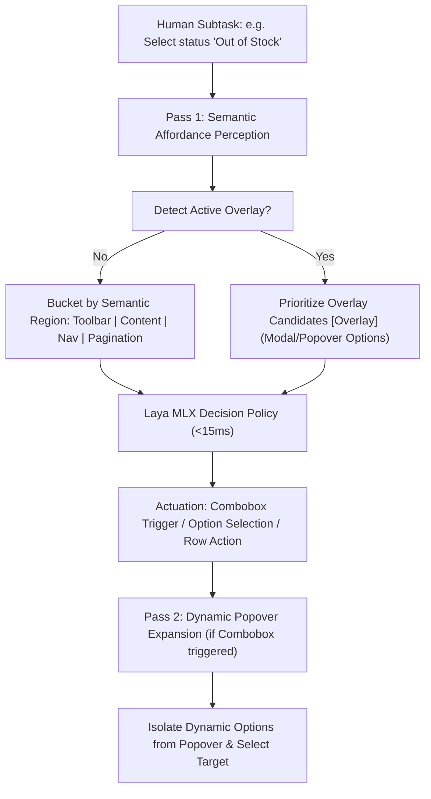

# 🏛️ Laya Browser Agent: Technical Architecture Specification

> **A 100% Local, Sub-Second Autonomous Web Agent Powered by Apple Silicon Metal GPU Decision Models, Dynamic Intent Decomposition, and WebMCP**

---

## 1. Architectural Philosophy: Beyond the Token & Cost Trap

Traditional autonomous browser agents (built on Claude 3.5 Sonnet, GPT-4o, or cloud vision models) suffer from three critical bottlenecks:
1. **Extreme Financial Cost**: Every step consumes 15,000–45,000 tokens of raw HTML, DOM trees, and high-resolution screenshots, costing **$0.50 to $2.50 per workflow**.
2. **High Latency**: Cloud roundtrips and token-by-token generation take **4 to 12 seconds per step**, resulting in sluggish 30-to-60-second browser workflows.
3. **Context Collapse & Hallucination**: Flooding 50,000 tokens of noisy HTML into an LLM causes lost-in-the-middle phenomena, missed buttons, and hallucinated coordinates.

**The Laya Browser Agent Paradigm:**
Instead of brute-forcing massive HTML dumps into giant cloud LLMs, Laya Browser Agent decomposes web automation into a **3-tier, zero-cost, local-first pipeline**:

```
┌────────────────────────────────────────────────────────────────────────┐
│                        USER / TERMINAL CLI                             │
│       laya-agent "http://localhost:3000" --task "<Human Request>"      │
└───────────────────────────────────┬────────────────────────────────────┘
                                    │
                                    ▼
┌────────────────────────────────────────────────────────────────────────┐
│ TIER 1: Natural Language Slot & Intent Planner (Ollama llama3.1:8b)    │
│    • Decomposes arbitrary goals into sequential subtasks               │
│    • Extracts parameter slots (credentials, queries, quantities, IDs) │
│    • 100% generic: zero pre-programmed intent tables or verb lists     │
└───────────────────────────────────┬────────────────────────────────────┘
                                    │
                                    ▼
┌────────────────────────────────────────────────────────────────────────┐
│ TIER 2: Live Affordance Perception (In-Memory Chrome DevTools Protocol)│
│    • Introspects WebMCP tools (navigator.modelContext, <form toolname>)│
│    • Discovers interactive DOM elements (buttons, inputs, links, rows) │
│    • In-memory CDP evaluation in < 3ms (zero stale disk file caches)   │
└───────────────────▲───────────────┬────────────────────────────────────┘
                    │               │ Candidates Map
                    │ State Update  │ (Tools + Elements)
                    │               ▼
┌───────────────────┴────────────────────────────────────────────────────┐
│ TIER 3: System 1 Decision Policy (Laya MLX on Metal GPU in ~15ms)      │
│    • Evaluates active subtask against on-screen affordances            │
│    • Curated criteria <= 12 options fitting 192-token head budget      │
│    • Mandatory "other" negative sink prevents probability spillage     │
│    • Calibrated RLCD confidence gating with local LLM vision fallback  │
└───────────────────▲───────────────┬────────────────────────────────────┘
                    │               │ Winning Action + Coords / Params
                    │ Execution     │
                    │ Feedback      ▼
┌───────────────────┴────────────────────────────────────────────────────┐
│ Playwright Native Actuator & WebMCP Driver                             │
│    • Playwright Canonical Tools (click, fill, mousewheel, find, etc.)  │
│    • WebMCP RPC tool dispatch (native JSON callTool)                  │
│    • Playwright actionability auto-scroll into view                     │
│    • Bounded exploratory viewport scrolling for off-screen targets     │
└────────────────────────────────────────────────────────────────────────┘
```

---

## 2. Dynamic Intent Handling: Why We Do NOT Maintain a Hardcoded List

A frequent question in web automation is:
> *"Will we maintain a huge list of intents (e.g. buy, cancel, compare, check stock, export invoice)? What happens when a brand-new intent comes in?"*

**We maintain ZERO hardcoded intents or synonym dictionaries.** In real-world enterprise applications, user intents and web capabilities are infinite:
- *"Compare iPhone 16 and Samsung S24 specs and see which is in stock"*
- *"Export all Q3 invoice PDFs for orders above $500"*
- *"Cancel all my open orders that are in pending state and logout"*
- *"Toggle dark mode and update notification email"*

A hardcoded enum or dictionary of intents (e.g. `INTENTS = {"buy": ..., "cancel": ...}`) or synonym mapping (`synonyms = {"buy": ["order", "purchase"]}`) is an anti-pattern that fails as soon as an application introduces new wording or unforeseen workflows.

### How Arbitrary Goals Flow Dynamically:

1. **Zero-Shot Subtask Decomposition (Tier 1)**:
   - When the user provides an instruction, local Ollama (`llama3.1:8b`) receives the natural language instruction.
   - Using open-ended semantic reasoning, it decomposes the prompt into sequential subtasks:
     1. Search for Product A
     2. Check availability and price for Product A
     3. Search for Product B
     4. Check availability and price for Product B
     5. Compare the two and summarize results
   - No hardcoded intent catalog is consulted.

2. **Universal Affordance Extraction (Tier 2)**:
   - On the target web page, `extract_page_candidates` does not look for predefined verbs. It discovers whatever interactive affordances *that specific page* provides:
     - Registered WebMCP tools: e.g. `compare_products`, `check_inventory`, `get_product_details`
     - Visual DOM elements: buttons like `<button>Compare</button>`, `<button>Check Stock</button>`, search inputs, dropdowns.
   - It builds an ad-hoc menu of options available *on this screen right now*.

3. **System 1 Zero-Shot Decision Policy (Tier 3)**:
   - Laya MLX (`aac6fef/laya-mlx`) evaluates the active subtask against the candidate options on screen in a single forward pass (~15ms on Apple Silicon Metal GPU).
   - Candidate descriptions are phrased as natural action semantics (e.g. `"Cancel order 3491f364"`, `"Navigate to Products page"`).
   - If confidence is below the safety threshold (0.85) or `"other"` is selected, the local LLM Router acts as a fallback safety valve.

---

## 3. Real-Time Affordance Perception (Why Disk Site Maps Were Eliminated)

In early designs, route interactive elements were serialized to disk JSON files (e.g. `.site_maps/<app_key>.json`). In production, this proved to be an anti-pattern:
1. **Stale Dynamic State**: Modern web applications frequently change DOM elements (e.g. order cancel buttons disappear once clicked, rows update from `PENDING` to `CANCELLED`, accordions expand/collapse). Caching button coordinates and dynamic entity IDs on disk served stale elements.
2. **In-Memory CDP is Instantaneous**: Extracting live interactive elements via Playwright / Chrome DevTools Protocol (`querySelectorAll` + `window.modelContext`) takes **< 3ms in memory**. Disk caching added serialization overhead and cache-invalidation bugs without performance benefit.
3. **Session-Scoped Route Telemetry**: Discovered route affordances are retained in memory solely for the execution report (`reports/execution_report.md`), with zero disk serialization.

---

## 4. Laya MLX Decision Architecture & Prompt Formatting

Laya is an open-source, non-autoregressive **System 1 decision model** (built on a ModernBERT-large backbone, ~421M parameters) developed by Convai Innovations. It evaluates typed questions over an input `state` in a single forward pass without token-by-token generation.

### Internal Token Budget & Layout
Under the hood, Laya packs the question, options, and state into a rigid sequence:
```text
[CLS] choice question: <instructions> [SEP] [MASK] <label_1>: <crit_1> [MASK] <label_2>: <crit_2> ... [SEP] <state> [SEP]
```

Laya has a fixed **192-token budget** for the question prefix and all option descriptions combined (`head_max_len = 192`):
- If an agent dumps 30–50 raw DOM elements into `criteria`, Laya's internal tokenizer truncates each option down to **4 tokens**, destroying semantic meaning.
- Laya Browser Agent curates candidates to **<= 12 focused choices** (tools, matched navigation links, matched action buttons, and general affordances).

### Mandatory Negative Sink (`"other"`)
Because Laya computes softmax across choices, the probabilities must mathematically sum to 1.0. If all visible options are irrelevant to the active step, the absence of a negative option forces probability mass onto unrelated buttons (such as `tool_logout_user`).

Every choice question in Laya Browser Agent strictly includes:
```python
"other": "None of the other options fits the active step or the required element is not on this screen"
```

### Unpolluted State Representation
Bidirectional encoder models attend to all tokens in the `state`. If `state` includes the entire user prompt (e.g. *"login, cancel orders, and logout"*), the model attends to the future verb *"logout"* prematurely. Laya Browser Agent passes clean context focusing on the **active subtask** and current screen context:
```python
state = (
    f"Active Objective: {subtask}\n"
    f"Current URL: {current_url}\n"
    f"Visible Screen Elements: {visible_summary}"
)
```

### Calibrated Confidence Gating & Guardrails
- **Threshold Gating**: Laya is trained with Reinforcement Learning for Calibrated Decisions (RLCD). When confidence is < 0.85 or `"other"` is selected, the agent falls back to the local LLM vision locator rather than guessing.
- **Session Protection Invariant**: `tool_logout_user` is strictly rejected unless the active subtask explicitly intends to log out.

---

## 5. Deep Table & Row Perception

Modern enterprise web applications (e.g., PostQode Nexus, Jira, ServiceNow) present dynamic data in scrollable tables with hundreds of rows.

1. **Below-the-Fold Row Inspection**:
   - `get_screen_elements()` scans table rows (`tr, [data-row], .card, li`) down to 8000px.
   - Buttons without explicit text (e.g., Lucide SVG icon buttons: checkmarks, cross marks, trash cans) are semantically labeled with row context (e.g., `Cancel 246c2c2e...`, `Approve 7e618872...`).
2. **Auto-Scroll Actuation & Playwright Locators**:
   - `driver.click(target, x, y)` and `driver.fill(target, value, ...)` use Playwright native locators (`button:has-text()`, `tr:has-text()`, `locator.scroll_into_view_if_needed()`) which automatically scroll the target into view, verify actionability, and click/type. Coordinate clicks are retained strictly as a fallback.
3. **Dynamic Target Entity Filtering**:
   - When an active subtask targets a specific ID token (e.g. `246c2c2e`), non-matching row buttons are filtered out so distractor rows do not crowd the decision model's choice space.

---

## 6. Execution Reporting & Visual Proof

Every run automatically generates a comprehensive Markdown report (`reports/execution_report.md` by default) containing:
- **Executive Summary**: Status, total time, average decision latency per step, cloud API cost ($0.00).
- **Structured Plan & Entity Resolution**: Extracted parameters with masked passwords (`••••••••`).
- **Step-by-Step Action Audit Trail**: Exact URL, subtask, action chosen, confidence %, latency, and tool return data.
- **Discovered Web Application Affordances**: Interactive capabilities discovered during the session.
- **Visual Verification Proof**: An embedded high-resolution screenshot (`final_execution_state.png`) proving the final state of the application.

---

## 7. Zero Cloud Cost Guarantee

| Component | Technology | Cost |
| :--- | :--- | :--- |
| **Decision Policy** | Laya MLX (`aac6fef/laya-mlx`) on Apple Silicon GPU | **$0.00** |
| **Intent Planner** | Local Ollama (`llama3.1:8b`) on localhost:11434 | **$0.00** |
| **Browser Engine** | Playwright Chromium (Headed / Headless) | **$0.00** |
| **Total Cloud API Spend** | **0 Cloud API Calls** | **$0.00** |

---

## 8. Playwright Native Tools, Viewport Exploration & Universal Primitives

Instead of relying on fragile coordinate math (`document.elementFromPoint`) or single-purpose string shortcuts, the agent aligns directly with the canonical Playwright tool suite (as defined in `playwright-cli` and the Playwright MCP specification):

```text
Playwright Native Primitives:
  click <target>              # Auto-scrolls target into view, verifies actionability, and clicks
  fill <target> <text>        # Auto-scrolls, clears, and fills input/form fields
  find [text]                 # Searches entire page accessibility tree & DOM (even off-screen)
  mousewheel <dx> <dy>        # Native scrolling up / down across the page or scroll containers
  screenshot [target]         # Captures page or element screenshot
  go-back / reload            # Browser navigation history and refresh
  dialog-accept / dismiss     # Modal dialog and alert handling

WebMCP Tools:
  webmcp-list                 # List WebMCP tools registered by the page
  webmcp-call <name>          # Execute a registered WebMCP tool
```

---

### Autonomous Off-Screen & Viewport Exploration

In real-world web applications, elements are frequently not visible on the initial screen fold (e.g. table rows below the fold, virtualized/lazy-loaded feeds, sticky container scrolls, submit buttons at the bottom of long forms). The agent handles this systematically:

1. **Playwright Auto-Scroll Actionability**:
   - For all target clicks (`click_<target>`) and form inputs (`input_<field>`), Playwright's native locator (`page.locator()`, `get_by_role()`, `get_by_text()`) automatically scrolls the element into view—even if it is 3,000px down the page or nested inside an overflow container.

2. **Scroll-State Perception (`get_scroll_state`)**:
   - The driver inspects both the main `window` and any scrollable container (`overflow-y: auto / scroll`) to determine:
     - `can_scroll_down`: whether additional content exists below the fold.
     - `can_scroll_up`: whether content exists above the current scroll position.
     - `scroll_top`, `scroll_height`, and `client_height`.

3. **Exploratory Viewport Actions vs. Operational Subtasks**:
   - If an operational subtask (e.g. *"Cancel order 360f30c4"*) targets an element not yet rendered or in a virtualized feed:
     - The decision engine (`LayaEngine`) or local router issues `browser_scroll_down` (via Playwright `mousewheel`).
     - **Invariant**: Intermediate exploratory scrolling does **NOT** advance or skip the operational subtask. The subtask remains active while fresh screen elements are revealed, allowing the agent to locate and click the target on the next step.
     - Bounded exploration (max 3 consecutive scrolls) prevents infinite loops when an item is truly absent from the application.

4. **Deterministic Fast-Path (< 10ms)**:
   - When a user prompt explicitly requests a browser utility (e.g. *"take a screenshot"*, *"scroll to the bottom"*, *"reload"*), the agent dispatches directly to the Playwright driver in ~10ms, bypassing model tokenization entirely.

---

### Sub-Second Latency Calibration

1. **Calibrated Confidence Threshold (`0.75`)**:
   - Softmax over 10–12 live page affordances frequently yields confident System 1 predictions between 0.75 and 0.85. Calibrating the threshold to `0.75` allows Laya MLX to execute without unnecessarily falling back to the 10+ second local LLM.

2. **Event-Driven DOM Settling**:
   - Replaced multi-second fixed sleeps with Playwright event-driven settling (`domcontentloaded` + 300ms network settling cap), cutting multi-step workflow execution times from ~90s down to sub-35s.

---

## 9. Hierarchical & Progressive 2-Pass Extraction (Region Decomposition & Overlay Priority)

In complex enterprise single-page applications, flat DOM extraction (extracting all 50–100 clickable elements in viewport) introduces three major failure modes:
1. **Affordance Conflation**: An agent looking for a filter or status dropdown might inadvertently fill a neighboring keyword search box because both are labeled with similar entity nouns.
2. **Token Spillage**: Overcrowding the decision model's context with 50+ background buttons leaves no token head budget for precise descriptions.
3. **Modal & Popover Occlusion**: When a dropdown popover, confirmation modal, or drawer opens, elements in the background are visually obscured and inert, yet flat extraction treats them with equal weight.

### 9.1 Semantic Region Decomposition

Every interactive element extracted by `get_screen_elements()` is dynamically classified into one of five semantic landmarks:

| Region | Target DOM Selectors | Purpose & Examples |
| :--- | :--- | :--- |
| `overlay` | `dialog, [role="dialog"], [role="menu"], [role="listbox"], [data-radix-popper-content-wrapper]` | Active modal windows, opened combobox option lists, confirmation popups. |
| `toolbar` | `form, [role="search"], [role="toolbar"], [role="combobox"], select, input, .filters` | Search bars, filter dropdowns, sort selectors, action toolbars. |
| `content` | `table, tbody, [data-row], .grid, main` | Data tables, product lists, row action buttons (Buy, Cancel, Approve). |
| `navigation` | `header, nav, [role="navigation"]` | Main menu tabs, top bar routes (`/dashboard`, `/products`, `/orders`). |
| `pagination` | `nav[aria-label*="pagination" i], .pagination, button:has-text("Next")` | Next/previous page buttons, page numbers. |

### 9.2 The Progressive 2-Pass Pipeline



1. **Pass 1 (Global Affordance Perception & Region Tagging)**:
   - `extract_page_candidates` extracts all interactive elements, tagging each with its region and type (`[Toolbar]`, `[Navigation]`, `[Content]`, `[Overlay]`, `[Pagination]`).
   - If an active overlay exists on screen, overlay candidates are automatically prioritized at the head of the list.
2. **Pass 2 (Focused Expansion & Option Selection)**:
   - When a dropdown trigger or combobox is selected, `select_dropdown(target, value)` handles both traditional HTML `<select>` elements and modern ARIA comboboxes (Radix UI / Shadcn UI):
     - Clicks the combobox trigger (e.g. `All Status`).
     - Awaits the dynamic option popover.
     - Clicks the exact matching option (`Out of Stock`).

### 9.3 Multi-Page Pagination Loop Invariant & Below-The-Fold Reveal

In modern web applications (such as the PostQode Nexus product catalog), pagination bars reside at the bottom of data tables, frequently located below the initial 720px viewport fold:
- **Below-the-Fold Perception**: `get_screen_elements()` explicitly preserves pagination controls across the full document height (up to 8,000px) and retains `disabled: Boolean(el.disabled)` status for pagination buttons rather than pruning them.
- **Auto-Scroll Viewport Reveal**: During pagination loops, if `can_scroll_down` is true, the agent automatically executes viewport scrolling (`mousewheel(0, 500)`) to bring the bottom table rows and pagination controls into view.
- **Full-Page Screenshots**: `take_screenshot(path, full_page=True)` captures the entire scrollable document, guaranteeing that the filtered items and pagination controls are completely visible in verification reports.
- **State Machine**: The loop alternates: `Page Screenshot` -> `Click Next` -> `Page Screenshot` -> `Click Next` until the `Next` button has `disabled: True`, at which point the pagination loop completes and cleanly advances to the next subtask.

### 9.4 Intent Parameter Isolation

In `SlotExtractor`, parameter slots are strictly isolated by action semantics:
- Filter values (`status`, `option`, `dropdown`) are explicitly separated from text search keywords (`search`, `query`).
- Terms such as `"out of stock"`, `"active"`, `"all status"` are purged from search query slots, preventing the agent from typing filter names into free-text search inputs.

