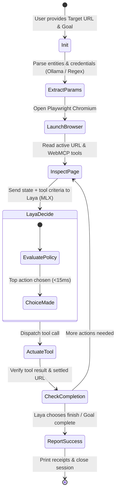

# Laya Browser Agent Agent: Architecture & Engineering Plan

> **Zero-Cost, Sub-Second Autonomous Web Agent Powered by Laya MLX Decision Models & WebMCP**

---

## 1. Executive Summary & Vision

Traditional AI web automation relies on brute-force approaches: scraping thousands of raw HTML/DOM lines, taking full-page vision screenshots, and passing 20,000–50,000 tokens into expensive cloud LLMs (Claude 3.5 Sonnet, GPT-4o). This results in:
* **High Financial Cost**: $0.50 to $2.00 per web workflow.
* **Extreme Latency**: 10–30 seconds of network round-trips and generative token streaming.
* **Context Window Collapse**: Local models (Ollama, Llama-3, Qwen) choke on massive 25k-token system prompts and complex DOM trees.

**The Solution:**
The convergence of two breakthrough technologies:
1. **WebMCP (Web Model Context Protocol)**: Exposes web applications as clean, structured, typed JSON tool APIs (`navigator.modelContext`, `document.modelContext`, `<form toolname="...">`). The entire state of a webpage drops from 20,000 tokens of messy HTML to **~80 tokens of clean JSON**.
2. **Laya (MLX)**: A sub-millisecond, typed decision model (`max_len: 512`) designed for choice evaluation and policy routing, running natively on Apple Silicon Metal GPU.

**Laya Browser Agent Agent** is a standalone, terminal-driven autonomous browser agent that executes complex web tasks with **$0.00 API cost**, **sub-20ms decision latency**, and **zero cloud dependencies**.

---

## 2. Core Architectural Pillars

```
┌────────────────────────────────────────────────────────────────────────┐
│                        USER / TERMINAL CLI                             │
│                  laya-agent "http://localhost:3000/login"              │
│       "Login as user (user/User@123), buy 1 item, and log out"         │
└───────────────────────────────────┬────────────────────────────────────┘
                                    │
                                    ▼
┌────────────────────────────────────────────────────────────────────────┐
│ 1. Parameter & Intent Extractor (Tier 0 - One Shot)                   │
│    • Parses user goal into structured intent & slots                   │
│    • Local Ollama (llama3.1:8b / qwen2.5) with instant regex fallback   │
│    • Output: { username: "user", password: "User@123", qty: 1 }        │
└───────────────────────────────────┬────────────────────────────────────┘
                                    │
                                    ▼
┌────────────────────────────────────────────────────────────────────────┐
│ 2. Laya MLX Decision Engine (The Brain - Sub-15ms Loop)                │
│    • Evaluates: Current State (URL, Goal, Active Context)              │
│    • Options: Available WebMCP Tools on Active Page + Control Actions  │
│    • Laya Predict: Chooses winning action via typed MLX policy         │
└───────────────────▲───────────────────────────────┬────────────────────┘
                    │ Tool Output                   │ Selected Tool
                    │ & State Update                │ & Parameters
                    │                               ▼
┌───────────────────┴────────────────────────────────────────────────────┐
│ 3. Playwright WebMCP Actuator (The Hands)                              │
│    • Connects to Chromium (--enable-features=WebMCP,WebMCPTesting)     │
│    • Introspects page.webmcp.tools() dynamically                       │
│    • Dispatches page.webmcp.callTool(action, params) natively          │
│    • Handles SPA transitions with route settling (waitForURL)          │
└────────────────────────────────────────────────────────────────────────┘
```

---

## 3. Detailed Component Architecture

### Component 1: Terminal CLI & UX (`laya_browser_agent/cli.py`)
* Inspired by clean developer CLI tools (e.g. `opencode`, `gh`, `rich`).
* **Modes**:
  * **Interactive Mode**: Prompts for Target URL and Goal with formatted spinners, progress steps, and live decision feeds.
  * **Direct CLI Flags**: `laya-agent --url <url> --task "<goal>" [--headed] [--model <hf_id>]`.
* Visual feedback displaying:
  * Active URL & Page Title
  * Discovered WebMCP tools on current route
  * Laya confidence score & selected action
  * Structured return values and completion receipts.

### Component 2: Parameter & Slot Extractor (`laya_browser_agent/extractor.py`)
Decision models excel at *choosing* between discrete options, but entity parameters (usernames, passwords, search keywords, UUIDs) need to be extracted from the user prompt:
* **Primary (Local Ollama)**: Queries local `http://localhost:11434/api/chat` with a tiny ~150-token prompt using local `llama3.1:8b` or `qwen2.5:7b` to extract structured JSON parameters.
* **Fallback (Regex / Heuristic)**: Instant deterministic parser for common patterns (`credentials (user / pass)`, quantities, URLs, IDs) requiring 0 ms and no external process.

### Component 3: Laya MLX Decision Engine (`laya_browser_agent/laya_engine.py`)
* Wraps `laya_mlx.Agent` pointing to `aac6fef/laya-mlx` (cached locally in Hugging Face cache).
* **State Formatting**:
  ```python
  state = f"Goal: {goal}\nCurrent URL: {page_url}\nLast Result: {last_result_summary}"
  ```
  *(Always stays under 100 tokens!)*
* **Question Formulation**:
  ```python
  questions = {
      "action": {
          "type": "choice",
          "instructions": "Which tool should be called next to make progress toward the user goal?",
          "criteria": {
              tool.name: tool.description for tool in available_webmcp_tools
          } | {
              "finish": "The goal has been fully achieved or verified",
              "navigate": "Navigate to another section of the application"
          }
      }
  }
  ```
* Evaluates action probabilities and picks the top decision in < 15ms.

### Component 4: Playwright WebMCP Actuator (`laya_browser_agent/browser.py`)
* Launches Chromium with WebMCP flags enabled:
  ```python
  args = ["--enable-features=WebMCP,WebMCPTesting", "--no-sandbox"]
  ```
* **Dynamic Tool Discovery**:
  Reads available tools from `page.evaluate("navigator.modelContext.getTools()")` or Playwright WebMCP API.
* **Actuation**:
  Executes `page.evaluate("navigator.modelContext.executeTool(...)")` or Playwright `callTool`.
* **SPA Route Settling**:
  Ensures client-side routing finishes before the next decision loop starts.

---

## 4. Execution Lifecycle & State Machine



---

## 5. Machine Inspection & Automated Bootstrap (`setup.sh`)

The repository will include an intelligent setup script (`setup.sh`) that inspects the host machine and sets up the environment without manual intervention:

1. **Hardware & Architecture Detection**:
   * Verifies macOS with Apple Silicon (M1/M2/M3/M4) for native MLX Metal GPU acceleration.
   * Provides CPU/PyTorch fallback guidelines if run on non-Apple hardware.
2. **Python Environment Verification**:
   * Checks for Python 3.11 or 3.12+.
   * Creates a dedicated virtualenv (`.venv`) or links to existing `laya-env`.
3. **Dependency Installation**:
   * Installs `laya-mlx`, `mlx`, `mlx-metal`, `playwright`, `rich`, `httpx`.
4. **Browser Provisioning**:
   * Runs `playwright install chromium` to guarantee headless/headed browser binaries exist.
5. **Model Verification**:
   * Checks local Hugging Face cache (`~/.cache/huggingface/hub/models--aac6fef--laya-mlx`).
   * Pre-caches model weights if missing.
6. **Ollama Service Inspection**:
   * Pings `http://localhost:11434/api/tags` to detect available local models (`llama3.1:8b`, `qwen2.5:7b`).

---

## 6. Repository File Layout

```
/Users/sreenuraj/laya-browser-agent/
├── doc/
│   └── plan.md                    # Master engineering blueprint (this document)
├── laya_browser_agent/                   # Core Python package
│   ├── __init__.py                # Package exports
│   ├── cli.py                     # Rich terminal UI & interactive prompt
│   ├── agent.py                   # Main autonomous decision orchestrator
│   ├── laya_engine.py             # Laya MLX decision wrapper & question builder
│   ├── extractor.py               # Parameter & slot extraction (Ollama + Regex)
│   └── browser.py                 # Playwright WebMCP driver & tool executor
├── setup.sh                       # Machine inspection & automated installer
├── run.sh                         # Quick-launch executable script
├── main.py                        # Python entry point
├── requirements.txt               # Pinned dependencies
├── README.md                      # Usage guide & examples
└── .gitignore                     # Clean repository exclusions
```

---

## 7. Target Metrics & Benchmarks

| Metric | Cloud LLM Web Agent (Claude/GPT-4o) | Laya Browser Agent Agent |
| :--- | :--- | :--- |
| **Cost per Task** | $0.50 – $2.00 | **$0.00 (Zero)** |
| **Decision Latency** | 3,000 ms – 8,000 ms per turn | **10 ms – 20 ms per turn** |
| **Context Size** | 20,000 – 50,000 tokens | **70 – 120 tokens** |
| **Memory Footprint** | Cloud hosted (Remote) | **~500 MB unified RAM (Local)** |
| **Cloud Dependency** | Requires active internet & API keys | **100% Offline Capable** |

---

## 8. Next Steps & Implementation Roadmap

1. **Step 1: Environment & Package Scaffolding**
   * Write `requirements.txt`, `.gitignore`, `README.md`, and `setup.sh`.
2. **Step 2: Core Actuator & Decision Bridge**
   * Implement `browser.py` for WebMCP Playwright actuation.
   * Implement `laya_engine.py` connecting `laya_mlx` with dynamic tool criteria.
3. **Step 3: Orchestrator & Slot Extractor**
   * Implement `extractor.py` and `agent.py` decision loop.
4. **Step 4: Terminal UX**
   * Build `cli.py` with `rich` terminal output for a clean CLI developer experience.
5. **Step 5: End-to-End Verification**
   * Run test tasks against WebMCP-enabled applications (e.g. PostQode Nexus) and record benchmarks.


---

## 9. Unified Dual-Engine: WebMCP + Laya-Vision (Traditional Web Support)

### The Multimodal Laya Breakthrough: `laya-vision`
Our research into the Laya ecosystem reveals **`laya-vision`** (`r33drichards/laya-vision` / Hugging Face `thaitea/laya-vision`):
* **Architecture**: A compact 201M-parameter vision decision model built on a pruned `SmolVLM-256M` backbone with a frozen vision tower.
* **Non-Generative**: Unlike traditional VLMs that generate word-by-word text descriptions, `laya-vision` evaluates an image/screenshot in a single forward pass and outputs calibrated choice/action probabilities directly.
* **Footprint**: Only ~400 MB of VRAM/unified memory, running locally on Apple Silicon / CPU in sub-100ms.

### Universal Hybrid Agent Architecture

By combining both engines, the agent becomes universal across **ANY** web application:

```
                      Target Webpage
                            │
              Has WebMCP modelContext?
                     /            \
                   YES             NO (Traditional Web)
                   /                \
          ┌──────────────┐     ┌──────────────────────┐
          │   Laya MLX   │     │     Laya-Vision      │
          │  Text Engine │     │   Multimodal Engine  │
          │  (aac6fef)   │     │ (thaitea/laya-vision)│
          └──────┬───────┘     └──────────┬───────────┘
                 │                        │
       Semantic Tool Calls         Pixel / Screenshot
     (page.webmcp.callTool)       Action Route (Click/Fill)
                 │                        │
                 ▼                        ▼
               15ms                     ~80ms
            Execution                 Execution
```

1. **WebMCP Sites (PostQode Nexus, WebMCP-enabled apps)**:
   - Evaluates active tools via `Laya MLX` in **15 ms**.
   - Zero visual processing required.
2. **Traditional Web Sites (Legacy apps, public SaaS without WebMCP)**:
   - Takes a viewport screenshot via `page.screenshot()`.
   - Passes the image to `laya-vision` with discrete action choices (`click_submit`, `click_nav_item`, `fill_search`).
   - Dispatches the UI action via standard Playwright locators.
3. **Total Cost**: Still **$0.00** across both modes, running 100% locally on the user machine!
